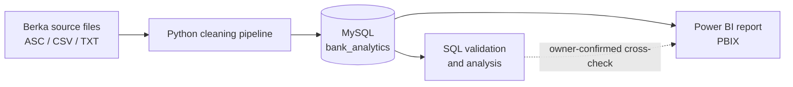

# Banking Analytics | Berka (PKDD'99) Dataset

An end-to-end banking analytics portfolio project built around the historical Czech Bank (Berka / PKDD'99) dataset. The repository contains a Python cleaning and MySQL-loading pipeline, SQL validation queries, automated Python regression checks, and a Power BI report.

> **Project status:** The project owner has completed the Power BI-to-MySQL cross-check and confirmed that the dashboard figures match the SQL results. Python source syntax and regression checks are covered by a successful GitHub Actions run. The cross-check is owner-confirmed; a machine-generated reconciliation log is not currently included in the repository.

## Project at a glance

| Component | Implementation |
|---|---|
| Dataset | Historical Czech Bank (Berka / PKDD'99) |
| Data preparation | Python, pandas, NumPy |
| Database | MySQL 8.0+ |
| SQL analysis | MySQL views, aggregations, data-quality and window-function checks |
| BI / reporting | Microsoft Power BI |
| Main deliverable | [Open the Power BI report file](./bank_analytics_Dashboard.pbix) |

## Architecture



The Python loader standardizes selected Czech labels, parses dates, derives client age and gender fields from the source birth-number field, applies duplicate/orphan and missing-value handling, and loads the resulting tables into MySQL. The SQL validation script defines five helper views: `v_account`, `v_client`, `v_trans`, `v_loan`, and `v_card`.

## Repository structure

```text
Banking-Analytics/
├── bank_analytics_Dashboard.pbix
├── python/
│   └── berka_to_mysql.py
├── sql/
│   ├── Bank_Analytics_Dashboard_Validation.sql
│   └── Loan_Outcome_Crosscheck.sql
├── tests/
│   └── test_cleaning_helpers.py
├── .github/workflows/
│   └── python-tests.yml
├── docs/
│   ├── DASHBOARD_GUIDE.md
│   └── PROJECT_NOTES.md
├── .env.example
├── .gitignore
├── requirements.txt
└── README.md
```

## Getting started

### 1. Prerequisites

- Python 3.9+
- MySQL Server 8.0+
- MySQL Workbench (recommended for running the SQL validation script)
- Microsoft Power BI Desktop to open the report

### 2. Install Python dependencies

From the repository root:

```bash
python -m pip install -r requirements.txt
```

### 3. Prepare the source data

Place the original Berka `.asc`, `.csv`, or `.txt` source files in a local data folder. The loader searches within the folder configured by `BERKA_FOLDER`.

### 4. Configure the database connection

Copy `.env.example` to a local `.env` file or set the environment variables in your shell. Configure:

- `BERKA_FOLDER` — local folder containing the source data
- `BERKA_DB_HOST` — defaults to `localhost`
- `BERKA_DB_PORT` — defaults to `3306`
- `BERKA_DB_USER` — defaults to `root`
- `BERKA_DB_PASSWORD` — database password; prompted at runtime when not set
- `BERKA_DB_NAME` — defaults to `bank_analytics`

Do not commit your real `.env` file or credentials.

### 5. Run the data pipeline

```bash
python python/berka_to_mysql.py
```

The loader is designed to be non-destructive by default. It does not drop the database and stops if target tables already exist. Replacing existing tables requires the explicit opt-in setting `BERKA_ALLOW_TABLE_REPLACE=YES`. Back up the project database before any replacement run.

### 6. Run Python regression tests

The tests cover date parsing and key category mappings without requiring a MySQL connection:

```bash
python -m unittest discover -s tests -v
```

GitHub Actions runs these checks when relevant Python, test, dependency, or workflow files change. The latest recorded run completed successfully: [GitHub Actions run](https://github.com/bhupendra272003/Banking-Analytics/actions/runs/45009347913).

### 7. Run SQL validation

Open `sql/Bank_Analytics_Dashboard_Validation.sql` in MySQL Workbench and execute Section 0 first to create the helper views. Then run the relevant page-wise validation queries. The script uses `bank_analytics`; confirm that this is the intended project database before execution.

For a focused loan-outcome-by-duration check, run `sql/Loan_Outcome_Crosscheck.sql` after Section 0. It uses the same status labels produced by the Python loader.

### 8. Open the Power BI report

Download or clone the repository, then open `bank_analytics_Dashboard.pbix` in Power BI Desktop. A public Power BI Service link is not published in this README yet.

## Dashboard documentation

A concise, reviewer-ready [portfolio case study](./docs/PORTFOLIO_CASE_STUDY.md) summarizes the business questions, workflow, default-view dashboard figures, KPI interpretation, validation status, and known limitations. The detailed [dashboard guide](./docs/DASHBOARD_GUIDE.md) documents all seven report pages and their measure/filter caveats.

A page-by-page guide to the report, KPI formulas, slicer/filter caveats, historical-data interpretation, and reviewer walkthrough is available in [docs/DASHBOARD_GUIDE.md](./docs/DASHBOARD_GUIDE.md). It also lists the genuine screenshots still to be captured; no placeholder images are presented as dashboard evidence.

## Analysis and validation coverage

The SQL validation script includes:

- Dashboard KPI and visual cross-check queries
- Data-quality checks for row counts, duplicates, missing values, and orphan records
- Year-wise analysis
- Risk and loan analysis, including bad-loan patterns
- Customer and regional analysis
- Window-function examples, including rankings and running totals

The project owner has manually compared the Power BI dashboard figures with the corresponding MySQL query outputs and confirmed that they match. This confirmation is recorded here as project-owner validation; no separate reconciliation export or execution transcript is currently committed.

## Known limitations and interpretation notes

- The New vs Repeat Customers calculation is documented in the SQL source as an assumption; preserve that definition when interpreting the metric unless the exact Power BI DAX definition is added to the repository.
- Percentage-like SQL outputs should be interpreted using the corresponding Power BI measure's formatting and denominator.
- Dashboard screenshots and a public Power BI Service URL have not yet been added.
- The historical dataset should be described as a portfolio/training dataset, not as current live banking data.

## Privacy and responsible sharing

This project uses a historical dataset for portfolio analysis. Do not add database passwords, `.env` files, database dumps, or private customer information to the repository. Before publishing an interactive report publicly, inspect the complete semantic model and confirm that no sensitive or restricted information is exposed.

## Next improvements

- Add clear dashboard screenshots and page descriptions.
- Add a small, reproducible reconciliation output or validation log (without credentials or sensitive data).
- Document exact DAX definitions for any metrics currently described as assumptions.
- Add a Power BI Service link only after public-sharing permissions and data privacy have been checked.

---

**Author:** [Bhupendra Singh Deora](https://github.com/bhupendra272003)
