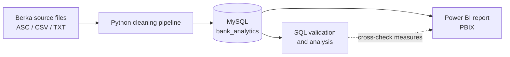

# Banking Analytics | Berka (PKDD'99) Dataset

An end-to-end banking analytics portfolio project built around the historical Czech Bank (Berka / PKDD'99) dataset. The repository contains a Python cleaning and MySQL-loading pipeline, SQL validation queries, and the Power BI report file.

> **Project status:** The Power BI `.pbix` file is included in this repository. Python source syntax was checked and SQL was reviewed statically. Live MySQL execution and full reconciliation of report measures against SQL are not yet verified.

## Project at a glance

| Component | Implementation |
|---|---|
| Dataset | Historical Czech Bank (Berka / PKDD'99) |
| Data preparation | Python, pandas, NumPy |
| Database | MySQL 8.0+ |
| SQL analysis | MySQL views, aggregations, data-quality and window-function checks |
| BI / reporting | Microsoft Power BI |
| Main deliverable | [Download the Power BI report](./bank_analytics_Dashboard.pbix) |

## Architecture



The Python loader standardizes selected Czech labels, parses dates, derives client age and gender fields from the source birth-number field, applies duplicate/orphan and missing-value handling, and loads the resulting tables into MySQL. The SQL validation script defines five helper views: `v_account`, `v_client`, `v_trans`, `v_loan`, and `v_card`.

## Repository structure

```text
Banking-Analytics/
├── bank_analytics_Dashboard.pbix
├── python/
│   └── berka_to_mysql.py
├── sql/
│   └── Bank_Analytics_Dashboard_Validation.sql
├── docs/
│   └── PROJECT_NOTES.md
├── .env.example
├── .gitignore
├── requirements.txt
└── README.md
```

## Getting started

### 1. Prerequisites

- Python 3.9+
- MySQL Server 8.0+
- MySQL Workbench (recommended for running the SQL validation script)
- Microsoft Power BI Desktop to open the report

### 2. Install Python dependencies

From the repository root:

```bash
python -m pip install -r requirements.txt
```

### 3. Prepare the source data

Place the original Berka `.asc`, `.csv`, or `.txt` source files in a local data folder. The loader searches within the folder configured by `BERKA_FOLDER`.

### 4. Configure the database connection

Copy `.env.example` to a local `.env` file or set the environment variables in your shell. Configure:

- `BERKA_FOLDER` — local folder containing the source data
- `BERKA_DB_HOST` — defaults to `localhost`
- `BERKA_DB_PORT` — defaults to `3306`
- `BERKA_DB_USER` — defaults to `root`
- `BERKA_DB_PASSWORD` — database password; prompted at runtime when not set
- `BERKA_DB_NAME` — defaults to `bank_analytics`

Do not commit your real `.env` file or credentials.

### 5. Run the data pipeline

```bash
python python/berka_to_mysql.py
```

The loader is designed to be non-destructive by default. It does not drop the database and stops if target tables already exist. Replacing existing tables requires the explicit opt-in setting `BERKA_ALLOW_TABLE_REPLACE=YES`. Back up the project database before any replacement run.

### 6. Run SQL validation

Open `sql/Bank_Analytics_Dashboard_Validation.sql` in MySQL Workbench and execute Section 0 first to create the helper views. Then run the relevant page-wise validation queries. The script uses `bank_analytics`; confirm that this is the intended project database before execution.

### 7. Open the Power BI report

Download or clone the repository, then open `bank_analytics_Dashboard.pbix` in Power BI Desktop. A public Power BI Service link is not published in this README yet.

## Analysis and validation coverage

The SQL validation script includes:

- Dashboard KPI and visual cross-check queries
- Data-quality checks for row counts, duplicates, missing values, and orphan records
- Year-wise analysis
- Risk and loan analysis, including bad-loan patterns
- Customer and regional analysis
- Window-function examples, including rankings and running totals

## Known limitations and interpretation notes

- Live execution against a MySQL instance and reconciliation against the Power BI report have not yet been verified.
- The SQL source documents the **New vs Repeat Customers** calculation as an assumption because the exact Power BI DAX definition was not available during SQL preparation.
- Percentage-like SQL outputs should be checked against the corresponding Power BI measure formatting.
- Dashboard screenshots and a public Power BI Service URL have not yet been added.

## Privacy and responsible sharing

This project uses a historical dataset for portfolio analysis. Do not add database passwords, `.env` files, database dumps, or private customer information to the repository. Before publishing an interactive report publicly, inspect the complete semantic model and confirm that no sensitive or restricted information is exposed.

## Next improvements

- Add verified dashboard screenshots and page descriptions.
- Execute the SQL validation script against the loaded MySQL database.
- Reconcile the Power BI measures with the SQL outputs and document confirmed findings.
- Add a Power BI Service link only after public-sharing permissions and data privacy have been checked.

## Contributors

- [Bhupendra Singh Deora](https://github.com/bhupendra272003) — Project owner
- [Kanishka Gurjar](https://github.com/kanishkagurjar05) — Dashboard collaborator (Power BI dashboard work)

---

**Author:** [Bhupendra Singh Deora](https://github.com/bhupendra272003)
